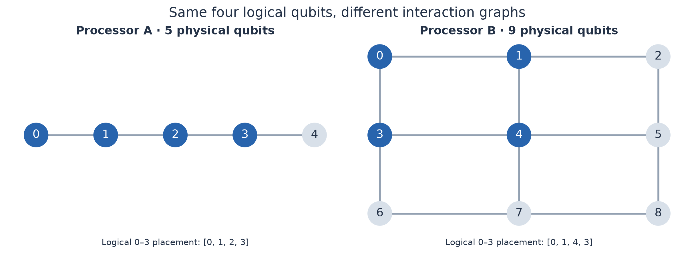
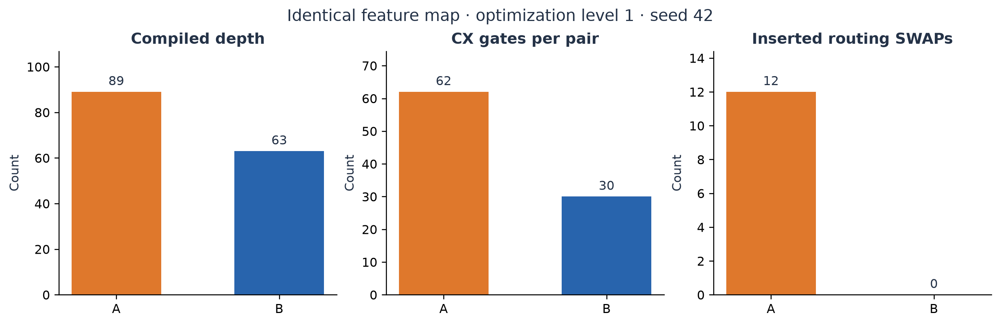
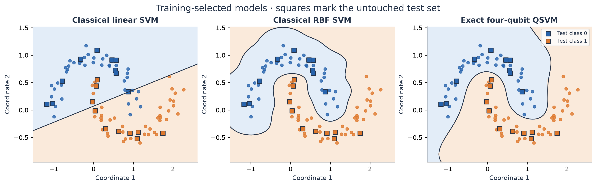

# Four-qubit QSVM: connectivity, kernel cost, and noise

**Qiskit Fall Fest 2026 · Phase 1 · PS-Q2**

We estimate a four-qubit fidelity kernel, train a classical SVM, and measure how two participant-defined processor graphs affect routing and kernel quality. Processor A is a five-node chain; Processor B is a nine-node square lattice. The quantum algorithm and synthetic noise rates are identical on both.

## Measured result

The training-selected exact QSVM achieved **100%** held-out accuracy. The RBF baseline achieved **100%**. At the official 4096 shots, noisy PSD-corrected QSVM accuracy was **90% on A** and **100% on B**.

For the same parameterized overlap circuit, B used **51.6% fewer CX gates** and **29.2% less depth** than A. These are simulator results for the documented synthetic architectures, not measurements of deployed hardware and not a quantum-advantage claim.

Across 20 shot-resampling realizations at the official budget, mean accuracy was A=96.25% (SD 3.58%) and B=96.75% (SD 3.73%). The single-seed accuracy gap is therefore not strong evidence of a stable classification advantage. The gate-cost reduction and lower kernel distortion are the clearer architecture findings.




## Run from a clean environment

Python **3.12** was used. From the repository root:

```bash
python -m venv .venv
# Windows PowerShell
.venv\Scripts\Activate.ps1
# macOS/Linux: source .venv/bin/activate
python -m pip install -r requirements.txt
python -m pytest -q
python -m src.experiment
```

Open `main.ipynb` using this environment and run all cells. It calls the same implementation as the CLI. The default run measures 4,840 circuits per processor at 4,096 shots, including 80 noisy self-overlap diagnostics. Aer density-matrix simulation avoids a separate noisy statevector evolution for every shot. Batch checkpoints resume interrupted runs; clear `results/.cache/` for a fresh measurement run. Cache keys include circuit, processor, inputs, seed, shots, batch size, and Qiskit/Aer versions. Original simulation timings are preserved and cache reuse is disclosed.

Pinned dependencies and `requirements.lock.txt` capture the tested environment. `results/manifest.json` records versions, settings, selected model, predictions, compilation checks, and timings. `results/checksums.json` fingerprints source/configuration/data/result artifacts.

## Experiment contract

- Dataset: `make_moons(n_samples=100, noise=0.1, random_state=42)`.
- Stratified 80/20 split, seed 42. PS-Q2 does not prescribe this split.
- Two scaled coordinates `(a,b)` populate four qubits as `(a,b,a,b)`.
- Each feature-map layer applies H, RZ(2 theta), and data-dependent RZZ(2 theta_i theta_j), where theta = scale × encoded coordinates.
- Five-fold training-only cross-validation chooses repetitions, scale, and SVM C. Every fold fits its own scaler. Held-out labels never choose the primary model.
- Frozen feature map: ring interactions, **2 repetition(s), scale 0.25**, SVM **C=100.0**.
- Fidelity uses global compute–uncompute all-zero probability on four logical qubits.
- Native gates: rz/sx/x/cx. Optimization level 1, transpiler seed 42. Same graph-distance layout rule on both processors, followed by SABRE routing.
- Identical noise: 1q depolarizing parameter 0.001 on rz/sx/x, CX depolarizing parameter 0.005, symmetric independent readout flips 0.01.
- Exact statevectors validate the kernel and physical output mapping. Noiseless shot estimates use exact binomial sampling, explicitly separate from noisy Aer circuit measurements.
- Raw matrices and complete 16-outcome histograms are preserved. PSD correction uses a training-derived eigenspace and a consistent test extension.
- Known-channel readout correction is an optional model-assisted ablation; it does not remove gate errors and uses no claimed hardware calibration.

## Results

| Model | Test accuracy | F1 |
|---|---:|---:|
| Classical LINEAR | 85% | 0.824 |
| Classical RBF | 100% | 1.000 |
| Exact QSVM | 100% | 1.000 |
| Ideal shot QSVM | 100% | 1.000 |
| A noisy raw | 95% | 0.947 |
| A noisy PSD | 90% | 0.889 |
| A noise expectation PSD | 100% | 1.000 |
| A readout-mitigated PSD | 90% | 0.889 |
| B noisy raw | 95% | 0.947 |
| B noisy PSD | 100% | 1.000 |
| B noise expectation PSD | 100% | 1.000 |
| B readout-mitigated PSD | 100% | 1.000 |

Each test error changes accuracy by five percentage points. Interpret differences with the small test size in mind; confidence intervals and 20 shot-resampling trials are available in the exported tables.



Boundary plots use exact simulation for illustration. They do not spend hardware shots and do not represent the noisy classifiers' boundaries.

## Repository map

```text
main.ipynb                  Executed end-to-end experiment and interpretation
requirements.txt           Pinned direct dependencies
requirements.lock.txt      Complete tested dependency freeze
data/raw/                  Generated points, labels, split membership
data/processed/            Exact/noisy kernels, states, histograms, probability oracles
processors/                Participant-defined A/B JSON configurations
src/problem.py             Dataset and four-qubit feature map, no cost Hamiltonian needed
src/processors.py          Coupling graphs and synthetic noise
src/routing.py             Layout, transpilation, mapping validation, SWAP accounting
src/kernels.py             Pair scheduling, batching, measurement caches
src/metrics.py             Diagnostics, PSD extension, classifier metrics
src/selection.py           Leakage-free training-only model selection
src/experiment.py          Complete experiment entry point
src/visualization.py       Scientific plots
src/documentation.py       Documentation generated from measured results
tests/                     Mathematical, routing, noise, and artifact checks
results/tables/            CSV and JSON comparison tables
results/figures/           Exported plots
assets/circuits/            Native compiled circuits in QPY and readable text
report.md                  Architecture analysis, controls, limitations, sources
SUBMISSION_CHECKLIST.md    Final submission checks
```

See [report.md](report.md) for the scientific analysis. Phase 1 uses A and B only. The master guide lists submission of the public GitHub URL at https://qffsrmap2026.com/learning/hackathon by **14 October 2026, 23:59 IST**. Publication and portal submission are separate from local experiment completion.
