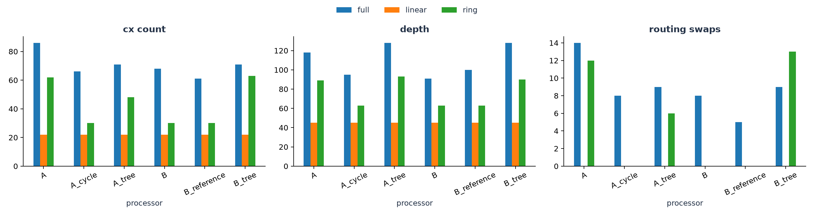
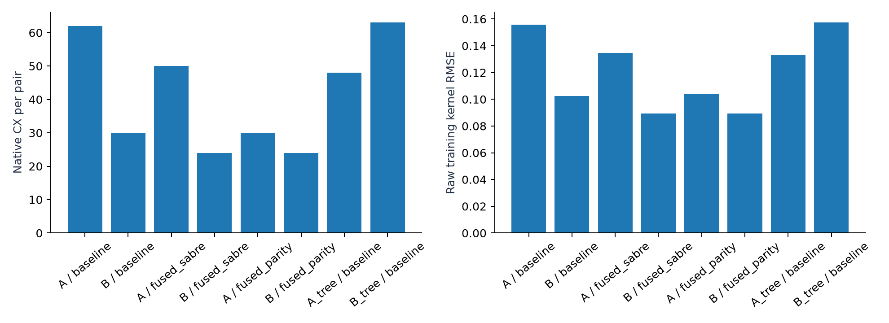
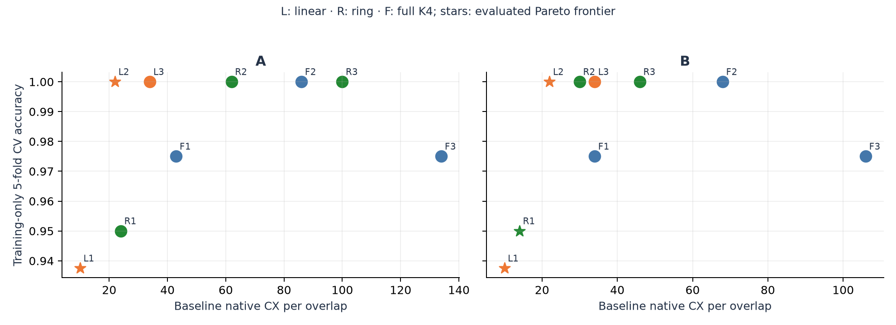

# Four-qubit QSVM: connectivity, kernel cost, and noise

**Qiskit Fall Fest 2026 · Phase 1 · PS-Q2**

We estimate a four-qubit fidelity kernel, train a classical SVM, and measure how two participant-defined processor graphs affect routing and kernel quality. Processor A is a five-node chain; Processor B is a nine-node square lattice. The quantum algorithm and synthetic noise rates are identical on both.

## Architecture exploration and exact circuit optimization

| Processor | Compiler | Depth | CX | SWAP | Raw RMSE | Test accuracy | Circuits | Aer seconds |
|---|---|---:|---:|---:|---:|---:|---:|---:|
| A | baseline | 89 | 62 | 12 | 0.1558 | 90% | 4840 | 33.9096 |
| B | baseline | 63 | 30 | 0 | 0.1024 | 100% | 4840 | 32.2041 |
| A | fused_sabre | 74 | 50 | 10 | 0.1347 | 90% | 4840 | 43.5545 |
| B | fused_sabre | 52 | 24 | 0 | 0.0895 | 100% | 4840 | 39.9267 |
| A | fused_parity | 52 | 30 | 0 | 0.1042 | 100% | 4840 | 43.3491 |
| B | fused_parity | 52 | 24 | 0 | 0.0895 | 100% | 4840 | 33.9488 |
| A_tree | baseline | 93 | 48 | 6 | 0.1333 | 90% | 4840 | 42.2415 |
| B_tree | baseline | 90 | 63 | 13 | 0.1573 | 90% | 4840 | 47.3667 |

All rows use the same training-selected kernel, C, 4,096-shot budget, and synthetic noise. Aer seconds are original simulator acquisition time, even when checkpoints are reused. They are not hardware execution estimates. The compiled template is reused for all 4,840 pairs. The fused-SABRE ablation isolates diagonal fusion from parity-network synthesis.
Accuracy uses the positive training eigenspace and its consistent held-out extension. RMSE uses the raw training kernel before that repair.

We compare three five-qubit graphs, chain/tree/cycle-plus-tail, and three nine-qubit graphs, square lattice/guide reference/tree. [The complete grid](results/tables/topology_grid.csv) contains 36 combinations of architecture, linear/ring/full K4 interaction, and BasicSwap/SABRE routing. This includes cases where the square's native four-cycle provides no automatic routing solution.

Under SABRE, full K4 interactions require 86 CX/118 depth on the chain, 68/91 on the square, and 61/100 on the guide reference. The reference has fewer CX gates but greater depth than the square, so the ranking depends on the objective. A five-node cycle uses 66/95, close to the nine-node square. The nine-node tree uses 63 CX for the ring, exceeding the five-node chain's 62. These controls show that qubit count, native interaction coverage, and routable parallelism are separate considerations. Their full-interaction results are compile-only; noisy kernel quality is measured only for the disclosed acquisition rows.




The new compiler merges the adjacent diagonal blocks in compute–uncompute, then synthesizes ring phases using native CX parity networks. For r repetitions, 2r diagonal blocks become 2r−1. A chain block uses ten CX gates; a native cycle block uses eight. All intermediate parities are uncomputed. The entire ideal unitary is preserved up to global phase; noise changes because fewer physical gates are executed. This is an exact compiler improvement, with no approximation or held-out score selection. It is not a claim of globally optimal synthesis.

See [the compiler derivation](docs/compiler_method.md) for explicit phase equations, native CX sequences, validation, and primary sources. The optimized seeded classifiers and their conditional shot-resampling results must be interpreted together; fewer gates need not improve the mean accuracy of an already accurate classifier.

For the frozen two-layer circuit, parity synthesis reduces A from 62 to 30 CX gates and depth 89 to 52; B falls from 30 to 24 CX and depth 63 to 52. Thus B's CX advantage over A shrinks from 51.6% under baseline routing to 20% after exact synthesis. Connectivity and compiler choice jointly determine cost. A naive routing comparison can overstate the irreducible topology penalty.

[Twenty paired shot-resampling trials](results/tables/compiler_resampling_summary.csv) cover every measured circuit variant. [Ten predeclared split seeds](results/tables/nested_split_robustness.csv) repeat training-only model selection and compare exact QSVM with independently tuned classical baselines. These splits reuse the prescribed dataset, and the robustness study uses exact kernels; it does not establish noisy-device or population superiority.

[Training-only cost/quality controls](results/tables/training_cost_quality.csv) compare linear/ring/full interactions at repetitions 1/2/3 with C selected inside the training set. Stars mark the observed CX-versus-CV Pareto frontier, not a proven global optimum. The primary model remains frozen. [Encoding controls](results/tables/encoding_training_control.csv) compare repeated coordinates with `(a,b,(a+b)/2,(a-b)/2)` using fold-fitted scaling and no held-out labels. These are post-selection diagnostics at the primary angle scale, not unbiased estimates of a newly chosen model.



### A lower-cost secondary model

The training-only rule first maximizes CV accuracy, then minimizes the worst A/B native CX count among tied candidates. At the primary angle scale it selects a two-layer **linear** feature map with C=100. This is a secondary model, separate from the frozen ring compiler comparison. Its 100% training CV score costs 22 CX gates on either processor. The kernel itself changes, so its RMSE uses its own exact reference.

| Processor | Depth | CX | Seeded test accuracy | RMSE versus its own exact kernel |
|---|---:|---:|---:|---:|
| A | 45 | 22 | 100% | 0.0891 |
| B | 45 | 22 | 100% | 0.0891 |

[Full measurements](results/tables/cost_aware_measurements.csv) and [20 shot-resampling trials](results/tables/cost_aware_resampling_summary.csv) are retained. This is conditional model selection at an already selected scale, not an unbiased new CV estimate or a change to the primary ring results.

The linear model's conditional shot-resampling mean is **92% on both processors**, compared with **96.25% on A and 96.5% on B** for the native-parity ring model. It is cheaper but less robust to shot fluctuations in this experiment. Ideal training CV and gate count alone do not predict noisy classification quality; the seeded 100% score should not be used to hide that tradeoff.


## Baseline measured result

The training-selected exact QSVM achieved **100%** held-out accuracy. The RBF baseline achieved **100%**. At the official 4096 shots, noisy PSD-corrected QSVM accuracy was **90% on A** and **100% on B**.

For the same parameterized overlap circuit, B used **51.6% fewer CX gates** and **29.2% less depth** than A. These are simulator results for the documented synthetic architectures, not measurements of deployed hardware and not a quantum-advantage claim.

Across 20 shot-resampling realizations at the official budget, mean accuracy was A=96.25% (SD 3.58%) and B=96.75% (SD 3.73%). The single-seed accuracy gap is therefore not strong evidence of a stable classification advantage. The gate-cost reduction and lower kernel distortion are the clearer architecture findings.


## Run from a clean environment

Python **3.12** was used. From the repository root:

```bash
python -m venv .venv
# Windows PowerShell
.venv\Scripts\Activate.ps1
# macOS/Linux: source .venv/bin/activate
python -m pip install -r requirements.lock.txt
python -m pytest -q
python -m src.experiment
```

Open `main.ipynb` using this environment and run all cells. It calls the same implementation as the CLI. The default run measures 4,840 circuits per processor at 4,096 shots, including 80 noisy self-overlap diagnostics. Aer density-matrix simulation avoids a separate noisy statevector evolution for every shot. Batch checkpoints resume interrupted runs; clear `results/.cache/` for a fresh measurement run. Cache keys include circuit, processor, inputs, seed, shots, batch size, and Qiskit/Aer versions. Original simulation timings are preserved and cache reuse is disclosed.

The measured complete pipeline runtime was 51.5 seconds with the disclosed cache state. A fresh run acquires 10 kernels, 48,400 circuits in total, and also repeats exact model selection on ten splits. Allow several minutes on a desktop CPU; timing depends on CPU and thread settings.

Pinned dependencies and `requirements.lock.txt` capture the tested environment. `results/manifest.json` records versions, settings, selected model, predictions, compilation checks, and timings. `results/checksums.json` fingerprints source/configuration/data/result artifacts.

## Experiment contract

- Dataset: `make_moons(n_samples=100, noise=0.1, random_state=42)`.
- Stratified 80/20 split, seed 42. PS-Q2 does not prescribe this split.
- Two scaled coordinates `(a,b)` populate four qubits as `(a,b,a,b)`. Repetition distributes both original coordinates over the required register without inventing independent features; the intervening Hadamards and ZZ phases create correlations. It is a disclosed design choice, not extra input information.
- Each feature-map layer applies H, RZ(2 theta), and data-dependent RZZ(2 theta_i theta_j), where theta = scale × encoded coordinates.
- Five-fold training-only cross-validation chooses repetitions, scale, and SVM C. Every fold fits its own scaler. Held-out labels never choose the primary model.
- Frozen feature map: ring interactions, **2 repetition(s), scale 0.25**, SVM **C=100.0**.
- Fidelity uses global compute–uncompute all-zero probability on four logical qubits.
- Native gates: rz/sx/x/cx. Optimization level 1, transpiler seed 42. Same graph-distance layout rule on both processors, followed by SABRE routing.
- Identical noise: 1q depolarizing parameter 0.001 on rz/sx/x, CX depolarizing parameter 0.005, symmetric independent readout flips 0.01.
- Exact statevectors validate the kernel and physical output mapping. Noiseless shot estimates use exact binomial sampling, explicitly separate from noisy Aer circuit measurements.
- Raw matrices and complete 16-outcome histograms are preserved. PSD correction uses a training-derived eigenspace and a consistent test extension.
- Known-channel readout correction is an optional model-assisted ablation; it does not remove gate errors and uses no claimed hardware calibration.

## Results

| Model | Test accuracy | F1 |
|---|---:|---:|
| Classical LINEAR | 85% | 0.824 |
| Classical RBF | 100% | 1.000 |
| Exact QSVM | 100% | 1.000 |
| Ideal shot QSVM | 100% | 1.000 |
| A noisy raw | 95% | 0.947 |
| A noisy PSD | 90% | 0.889 |
| A noise expectation PSD | 100% | 1.000 |
| A readout-mitigated PSD | 90% | 0.889 |
| B noisy raw | 95% | 0.947 |
| B noisy PSD | 100% | 1.000 |
| B noise expectation PSD | 100% | 1.000 |
| B readout-mitigated PSD | 100% | 1.000 |

Each test error changes accuracy by five percentage points. Interpret differences with the small test size in mind; confidence intervals and 20 shot-resampling trials are available in the exported tables.


Boundary plots use exact simulation for illustration. They do not spend hardware shots and do not represent the noisy classifiers' boundaries.

## Repository map

```text
main.ipynb                  Executed end-to-end experiment and interpretation
requirements.txt           Pinned direct dependencies
requirements.lock.txt      Complete tested dependency freeze
data/raw/                  Generated points, labels, split membership
data/processed/            Exact/noisy kernels, states, histograms, probability oracles
processors/                Participant-defined A/B JSON configurations
src/problem.py             Dataset and four-qubit feature map, no cost Hamiltonian needed
src/processors.py          Coupling graphs and synthetic noise
src/routing.py             Layout, transpilation, mapping validation, SWAP accounting
src/kernels.py             Pair scheduling, batching, measurement caches
src/metrics.py             Diagnostics, PSD extension, classifier metrics
src/selection.py           Leakage-free training-only model selection
src/experiment.py          Complete experiment entry point
src/visualization.py       Scientific plots
src/documentation.py       Documentation generated from measured results
tests/                     Mathematical, routing, noise, and artifact checks
results/tables/            CSV and JSON comparison tables
results/figures/           Exported plots
assets/circuits/            Native compiled circuits in QPY and readable text
report.md                  Architecture analysis, controls, limitations, sources
docs/                      Guide, judging notes, and submission checklist
```

See [report.md](report.md) for the scientific analysis and [docs/SUBMISSION_CHECKLIST.md](docs/SUBMISSION_CHECKLIST.md) for final checks. Phase 1 uses A and B only.
