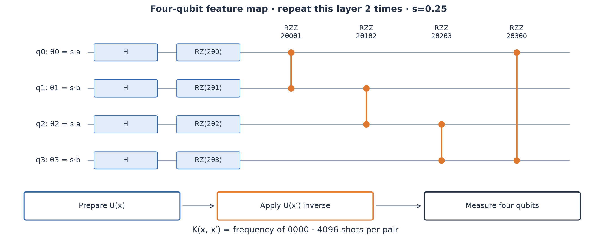
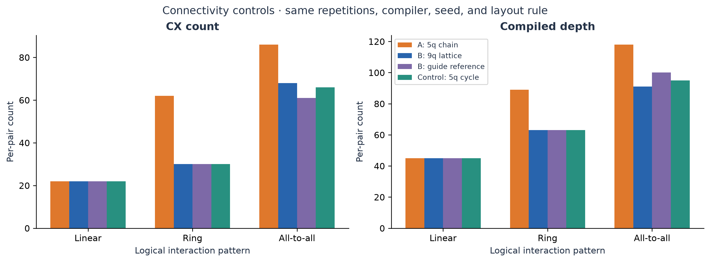
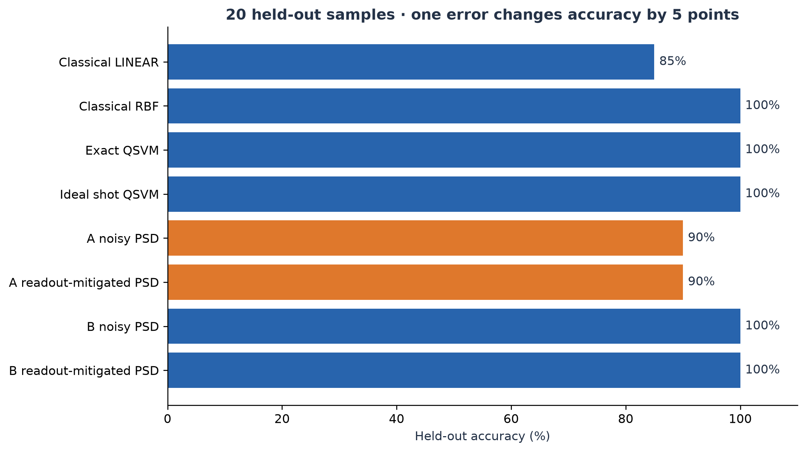
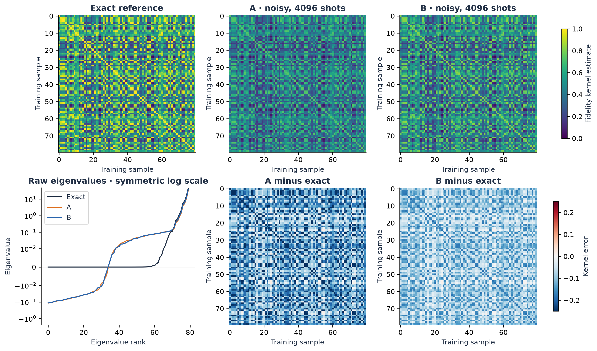
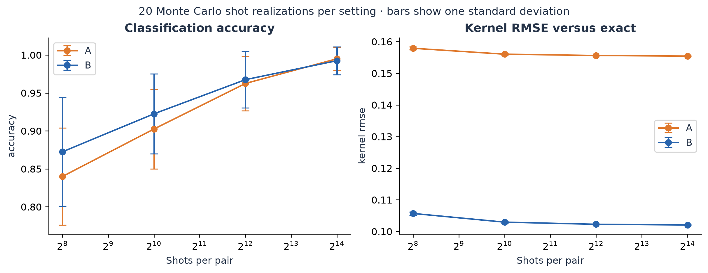

# PS-Q2 scientific report

## Research question

How does physical connectivity affect the cost of estimating the same four-qubit fidelity kernel, and do extra routed gates change kernel quality and classification under matched synthetic noise?

The task is hybrid: quantum circuits supply similarity estimates; scikit-learn trains the SVM classically. With four qubits, classical simulation is inexpensive. We make no speedup, superiority over RBF, or asymptotic quantum-advantage claim.

## Data and model selection

The prescribed 100-point moons dataset is split into 80 training and 20 held-out samples with stratification and seed 42. Training-only five-fold CV evaluates repetitions 1/2, scales 0.25/0.5/1/1.5, and C 0.1/1/10/100. A fresh MinMaxScaler maps fold-training data to [0, pi]; validation points use those limits without clipping. Ties prefer lower CV variation, fewer repetitions, lower scale, then lower C. The selected model has 2 repetitions, scale 0.25, C=100.0.

The two independent coordinates are repeated as `(a,b,a,b)` across four qubits. Derived coordinates or labels are not added. For each repetition, H on all four qubits precedes RZ(2 theta_i) and RZZ(2 theta_i theta_j) on a four-edge ring. theta_i equals the selected scale times the corresponding coordinate. Both rotations and entangling phases depend on data. A fixed final entangler would cancel from the overlap; this circuit does not rely on such a construction.

Linear and RBF baselines use fold-fitted preprocessing and the same five-fold split and C grid. RBF additionally evaluates gamma in scale/0.1/1/10. This is a reasonable baseline search, not an exhaustive classical optimization budget match. Quantum model selection uses exact simulation and is disclosed separately from the device kernel workload.

## Kernel definition and validation

Let phi(x) = U(x)|0000>. The kernel is K(x,x') = |<phi(x)|phi(x')>|². Preparing U(x) then applying U(x') inverse yields this value as the global all-zero measurement probability. No ancilla or second register is required.

The exact Gram matrix equals Tr(rho_x rho_x'), an inner product on density operators, so it is positive semidefinite. Exact diagonal entries equal one. Four-qubit states have 16 amplitudes; the fidelity kernel's operator feature representation has dimension at most 256, not merely 16 independent real features.

The exact reference's minimum eigenvalue is -3.614e-15. Compilation checks include self-overlap and distinct pairs on the actual physical output qubits. Maximum errors are A=5.329e-15, B=4.996e-15. These checks catch final routing permutations and measurement mapping errors.

## Architecture choices and routing controls

A is the five-node path 0–1–2–3–4. B is a participant-designed 3x3 square lattice with nine nodes and 12 undirected edges. All edges support CX in both directions. These choices comply with the guide's topology freedom. B is not described as an actual heavy-hex processor.

We enumerate four-logical-qubit placements using the same label-independent objective: minimize the sum of graph shortest-path distances over the feature-map interaction edges, then lexicographic tie-breaking. We compile the parameterized compute–uncompute template with SABRE routing, optimization level 1, and seed 42, and bind data afterward. Initial layouts are A=[0, 1, 2, 3], B=[0, 1, 4, 3]. This graph-only placement is reproducible but does not prove globally minimum routed depth or CX count.

SWAP count is captured immediately after the routing pass, before basis translation decomposes SWAPs into CX gates. Final CX count includes all routing and compiler optimizations. Multiplying SWAP count by three is not assumed to equal net CX overhead because adjacent gates may cancel.

The exported architecture table also includes BasicSwap routing, linear/ring/all-to-all logical interactions, repetitions 1/2/3, the guide's reference B graph, and a five-qubit cycle-plus-tail A control. These are structural controls, not additional measured noisy kernel runs. Exact classification for feature-map controls is reported with frozen scale/C and is post-selection exploratory analysis; it does not redefine the primary winner.

| Measure | A | B |
|---|---:|---:|
| Physical qubits | 5 | 9 |
| Compiled depth | 89 | 63 |
| CX gates per pair | 62 | 30 |
| 1q gates per pair | 80 | 80 |
| Inserted routing SWAPs | 12 | 0 |
| Measured pairs | 4840.0 | 4840.0 |
| Total shots | 19824640.0 | 19824640.0 |
| CX × shots × pairs | 1229127680.0 | 594739200.0 |

B reduces CX count by 51.6% and depth by 29.2% for this primary template. More physical qubits alone do not imply lower cost. A four-cycle is the specific graph property tested. Sparse linear logical interactions may need little or no routing on either architecture; the controls reveal whether the advantage persists under other interaction patterns.

The five-qubit cycle control tests the qubit-budget explanation directly: a five-qubit graph can also host the four-qubit ring without SWAPs. For linear interactions, the primary A and B both use 22 CX gates and depth 45. The guide's reference B also hosts the ring directly. The architecture benefit comes from matching connectivity to the interaction graph, and is not a general statement that nine qubits outperform five.

## Architecture exploration and exact circuit optimization

| Processor | Compiler | Depth | CX | SWAP | Raw RMSE | Test accuracy | Circuits | Aer seconds |
|---|---|---:|---:|---:|---:|---:|---:|---:|
| A | baseline | 89 | 62 | 12 | 0.1558 | 90% | 4840 | 33.9096 |
| B | baseline | 63 | 30 | 0 | 0.1024 | 100% | 4840 | 32.2041 |
| A | fused_sabre | 74 | 50 | 10 | 0.1347 | 90% | 4840 | 43.5545 |
| B | fused_sabre | 52 | 24 | 0 | 0.0895 | 100% | 4840 | 39.9267 |
| A | fused_parity | 52 | 30 | 0 | 0.1042 | 100% | 4840 | 43.3491 |
| B | fused_parity | 52 | 24 | 0 | 0.0895 | 100% | 4840 | 33.9488 |
| A_tree | baseline | 93 | 48 | 6 | 0.1333 | 90% | 4840 | 42.2415 |
| B_tree | baseline | 90 | 63 | 13 | 0.1573 | 90% | 4840 | 47.3667 |

All rows use the same training-selected kernel, C, 4,096-shot budget, and synthetic noise. Aer seconds are original simulator acquisition time, even when checkpoints are reused. They are not hardware execution estimates. The compiled template is reused for all 4,840 pairs. The fused-SABRE ablation isolates diagonal fusion from parity-network synthesis.
Accuracy uses the positive training eigenspace and its consistent held-out extension. RMSE uses the raw training kernel before that repair.

We compare three five-qubit graphs, chain/tree/cycle-plus-tail, and three nine-qubit graphs, square lattice/guide reference/tree. [The complete grid](results/tables/topology_grid.csv) contains 36 combinations of architecture, linear/ring/full K4 interaction, and BasicSwap/SABRE routing. This includes cases where the square's native four-cycle provides no automatic routing solution.

Under SABRE, full K4 interactions require 86 CX/118 depth on the chain, 68/91 on the square, and 61/100 on the guide reference. The reference has fewer CX gates but greater depth than the square, so the ranking depends on the objective. A five-node cycle uses 66/95, close to the nine-node square. The nine-node tree uses 63 CX for the ring, exceeding the five-node chain's 62. These controls show that qubit count, native interaction coverage, and routable parallelism are separate considerations. Their full-interaction results are compile-only; noisy kernel quality is measured only for the disclosed acquisition rows.

The new compiler merges the adjacent diagonal blocks in compute–uncompute, then synthesizes ring phases using native CX parity networks. For r repetitions, 2r diagonal blocks become 2r−1. A chain block uses ten CX gates; a native cycle block uses eight. All intermediate parities are uncomputed. The entire ideal unitary is preserved up to global phase; noise changes because fewer physical gates are executed. This is an exact compiler improvement, with no approximation or held-out score selection. It is not a claim of globally optimal synthesis.

See [the compiler derivation](docs/compiler_method.md) for explicit phase equations, native CX sequences, validation, and primary sources. The optimized seeded classifiers and their conditional shot-resampling results must be interpreted together; fewer gates need not improve the mean accuracy of an already accurate classifier.

For the frozen two-layer circuit, parity synthesis reduces A from 62 to 30 CX gates and depth 89 to 52; B falls from 30 to 24 CX and depth 63 to 52. Thus B's CX advantage over A shrinks from 51.6% under baseline routing to 20% after exact synthesis. Connectivity and compiler choice jointly determine cost. A naive routing comparison can overstate the irreducible topology penalty.

[Twenty paired shot-resampling trials](results/tables/compiler_resampling_summary.csv) cover every measured circuit variant. [Ten predeclared split seeds](results/tables/nested_split_robustness.csv) repeat training-only model selection and compare exact QSVM with independently tuned classical baselines. These splits reuse the prescribed dataset, and the robustness study uses exact kernels; it does not establish noisy-device or population superiority.

[Training-only cost/quality controls](results/tables/training_cost_quality.csv) compare linear/ring/full interactions at repetitions 1/2/3 with C selected inside the training set. Stars mark the observed CX-versus-CV Pareto frontier, not a proven global optimum. The primary model remains frozen. [Encoding controls](results/tables/encoding_training_control.csv) compare repeated coordinates with `(a,b,(a+b)/2,(a-b)/2)` using fold-fitted scaling and no held-out labels. These are post-selection diagnostics at the primary angle scale, not unbiased estimates of a newly chosen model.

### A lower-cost secondary model

The training-only rule first maximizes CV accuracy, then minimizes the worst A/B native CX count among tied candidates. At the primary angle scale it selects a two-layer **linear** feature map with C=100. This is a secondary model, separate from the frozen ring compiler comparison. Its 100% training CV score costs 22 CX gates on either processor. The kernel itself changes, so its RMSE uses its own exact reference.

| Processor | Depth | CX | Seeded test accuracy | RMSE versus its own exact kernel |
|---|---:|---:|---:|---:|
| A | 45 | 22 | 100% | 0.0891 |
| B | 45 | 22 | 100% | 0.0891 |

[Full measurements](results/tables/cost_aware_measurements.csv) and [20 shot-resampling trials](results/tables/cost_aware_resampling_summary.csv) are retained. This is conditional model selection at an already selected scale, not an unbiased new CV estimate or a change to the primary ring results.

The linear model's conditional shot-resampling mean is **92% on both processors**, compared with **96.25% on A and 96.5% on B** for the native-parity ring model. It is cheaper but less robust to shot fluctuations in this experiment. Ideal training CV and gate count alone do not predict noisy classification quality; the seeded 100% score should not be used to hide that tradeoff.

## Workload and timing definitions

For 80 training samples, the upper triangle including diagonals contains 3,240 pairs. Prediction needs 20×80=1,600 additional pairs, for 4,840 circuits per processor. At 4096 shots this is 19,824,640 shots per processor. The minimal ideal workload excluding known diagonal values is 4,760 pairs. We deliberately measure 80 diagonal diagnostics rather than quietly forcing noisy self-overlap to one.

The template is compiled before parameter binding. The same structural gate counts therefore apply to all evaluated pairs, including diagonal pairs; we do not recompile diagonal pairs into an empty circuit. Gates that cancel symbolically in the template are optimized normally. This is a clearly specified execution policy, not a lower bound on all possible kernel implementations.

`CX × shots × pairs` is an estimated hardware gate-execution workload. It is not the number of classical density-matrix operations. Aer propagates each noisy circuit density matrix and then samples measurements efficiently. Its idle-qubit truncation is enabled and simulator metadata is recorded. No gate durations, decoherence times, queue model, or hardware calibration exist in this synthetic task; hardware execution time is therefore not inferred from simulator wall time. Original Aer timings and cache reuse are recorded separately.

## Noise, shot error, and readout correction

Both models use exactly the same channels. The guide does not specify a virtual-RZ exemption, so the 0.001 one-qubit depolarizing channel is applied to rz, sx, and x on both. CX uses depolarizing parameter 0.005; readout flips each measured bit independently with probability 0.01. Qiskit's depolarizing parameter describes E(rho)=(1-p)rho+p I/d, not directly an average gate infidelity.

Noisy kernels come from actual Aer measurement histograms at 4096 shots, seeded by 42 plus each batch's start index. Full histograms and pre-readout distributions are saved. Applying the specified readout channel to those distributions yields an exact noisy expectation oracle. This separates gate/readout bias from finite-shot fluctuations.

For an all-zero probability p, the shot estimator standard error is sqrt(p(1-p)/S), at most 1/(2 sqrt(S)). At 4,096 shots the maximum is 0.0078125. More shots reduce variance, but cannot undo gate/readout bias. The sensitivity study uses 20 binomial realizations from the saved noisy expectation for each of 256/1,024/4,096/16,384 shots. These are Monte Carlo resampling trials, not 160 additional device kernel acquisitions. The same random seeds on A/B pair the trials, although probabilities differ.

Readout mitigation inverts the known independent-bit 16×16 channel. This is a model-assisted ablation, with exact synthetic calibration knowledge and no acquisition of calibration circuits. It corrects readout bias, not gate noise. Unclipped estimates are saved; values supplied to the corrected-kernel pipeline are clipped to [0,1]. Any variance increase or lack of accuracy improvement is retained rather than hidden.

## PSD correction and held-out consistency

Independent noisy pair measurements can produce an indefinite Gram matrix, even though the ideal kernel is PSD. We acquire one orientation per training pair and mirror the upper triangle; a reported symmetry error of zero is therefore enforced by assembly, not measured evidence of noisy-circuit symmetry. Noisy compute–uncompute circuits are operational estimators, not guaranteed mixed-state inner products. Noisy diagonal values are measured. The raw SVM is exploratory because an indefinite kernel need not give the usual convex SVM problem.

For the primary noisy classifier, diagonalize the symmetric training matrix and retain eigenvalues greater than 1e-8. Let V contain the retained eigenvectors and L their positive eigenvalues. Training features are V sqrt(L); held-out features are K_test,train V L^(-1/2). Consequently the repaired training kernel is V L V^T and the consistent cross-kernel is K_test,train V V^T. Only training-derived eigenvectors enter the correction; there is no test/test projection or test-label information. Raw matrices remain available for error diagnostics. The correction can change the classifier, so correction norms and retained ranks are exported.

| Processor | Raw RMSE | Expected-noise RMSE | Raw minimum eigenvalue |
|---|---:|---:|---:|
| A | 0.155762 | 0.155423 | -0.117024 |
| B | 0.102384 | 0.102018 | -0.113717 |

## Classification results

| Model | Test accuracy | F1 |
|---|---:|---:|
| Classical LINEAR | 85% | 0.824 |
| Classical RBF | 100% | 1.000 |
| Exact QSVM | 100% | 1.000 |
| Ideal shot QSVM | 100% | 1.000 |
| A noisy raw | 95% | 0.947 |
| A noisy PSD | 90% | 0.889 |
| A noise expectation PSD | 100% | 1.000 |
| A readout-mitigated PSD | 90% | 0.889 |
| B noisy raw | 95% | 0.947 |
| B noisy PSD | 100% | 1.000 |
| B noise expectation PSD | 100% | 1.000 |
| B readout-mitigated PSD | 100% | 1.000 |

The 20-sample holdout has five-percentage-point resolution. Wilson intervals are supplied for noisy variants, but this single synthetic split cannot establish general population superiority. Shot-resampling error bars quantify conditional shot variability, not uncertainty across newly generated datasets. The selected C is frozen across exact, sampled, noisy, and mitigated kernels, isolating execution effects; noise-aware retraining or tuning could produce different results.

Across 20 shot-resampling realizations at the official budget, mean accuracy was A=96.25% (SD 3.58%) and B=96.75% (SD 3.73%). The single-seed accuracy gap is therefore not strong evidence of a stable classification advantage. The gate-cost reduction and lower kernel distortion are the clearer architecture findings.

## Reproducibility and scope

`python -m src.experiment` executes the complete pipeline. `main.ipynb` provides the same run with figures and explanations. The raw dataset, split indices, scaled points, exact statevectors, raw kernels, full counts, expectation oracles, compiled QPY circuits, model selection scores, predictions, resource tables, checksums, and versions are included. The unit/integration suite tests overlap identities, mapped compilation, valid couplings, PSD extension, shot assembly, readout inversion, and saved-artifact consistency.

Only A and B are implemented, as required for Phase 1. No access to a cloud quantum processor is claimed. Kernel evaluation grows quadratically in training size; four qubits and this toy dataset make no scalability demonstration. The encoding repeats features, the topology is selected for a known ring interaction pattern, and comparison results apply to those disclosed choices. Decision-boundary plots are exact simulations and spend no measurement shots.

## Primary references

- [Master guide](docs/QFF_Phase_1_Master_Guide.pdf), pages 1–3, 5, and 7: task, architecture freedom, noise, repository, deadline, rubric.
- [Havlicek et al., quantum feature-space classifiers](https://arxiv.org/abs/1804.11326).
- [scikit-learn make_moons](https://scikit-learn.org/stable/modules/generated/sklearn.datasets.make_moons.html).
- [scikit-learn precomputed SVC](https://scikit-learn.org/stable/modules/generated/sklearn.svm.SVC.html).
- [scikit-learn leakage guidance](https://scikit-learn.org/stable/common_pitfalls.html).
- [Qiskit compute–uncompute fidelity](https://qiskit-community.github.io/qiskit-machine-learning/stubs/qiskit_machine_learning.state_fidelities.ComputeUncompute.html), mathematical method; the implementation here uses Aer directly rather than requiring Qiskit Machine Learning.
- [Qiskit transpiler](https://quantum.cloud.ibm.com/docs/en/api/qiskit/transpiler).
- [Aer density-matrix simulation](https://qiskit.github.io/qiskit-aer/stubs/qiskit_aer.AerSimulator.html).
- [Aer depolarizing channel](https://qiskit.github.io/qiskit-aer/stubs/qiskit_aer.noise.depolarizing_error.html).
